<div align="center">


# VComic (Comics & Gallery)

**Comics and galleries in one window.**

A multi-source manga reader and multi-site gallery browser for Windows desktop.<br/>
34 bundled JavaScript manga sources, Pixiv plus several gallery sites, a two-page reader, offline downloads, follow-updates tracking and reading statistics.

[](desktop/build.gradle.kts)
[](https://w13630039663-bit.github.io/Vcomic/#top)
[](gradle/libs.versions.toml)
[](gradle/libs.versions.toml)
[](#requirements-and-quick-start)
[](LICENSE)

[简体中文](README.md) | **English**

[Website](https://w13630039663-bit.github.io/Vcomic/#top) · [Screenshots](#screenshots) · [Features](#desktop-features) · [Download](#download-and-install) · [Build from source](#requirements-and-quick-start)

</div>

> [!NOTE]
> The Windows installer is currently unsigned (no commercial code-signing certificate). When running a downloaded `.exe` for the first time, if your browser or Windows Defender SmartScreen shows an "Unknown publisher" warning, click **"More info" → "Run anyway"** to proceed. The project is fully open source and can also be built from source.

---

## What is this

VComic is a multi-platform comics and gallery project with three parts:

| Part | Description | Form |
|---|---|---|
| **Windows desktop** (this repository) | Native single-window app built with Kotlin and Compose Multiplatform; all UI and business code is desktop-owned | `.exe` installer / portable folder |
| **Android app** | Mobile build sharing the same origin but with its own UI, styled with Miuix and Material 3 | APK (Android 13+) |
| **Official landing page** | Static HTML page with interactive feature demos | [Live site](https://w13630039663-bit.github.io/Vcomic/#top) / `index.html` |

The desktop build has removed the original Android `:app` module and its source mappings. An embedded QuickJS engine runs the manga source plugins. Data formats stay compatible with the Android app, so `.venera` backups can move between platforms.

---

## Screenshots

### Windows desktop

<p align="center">
  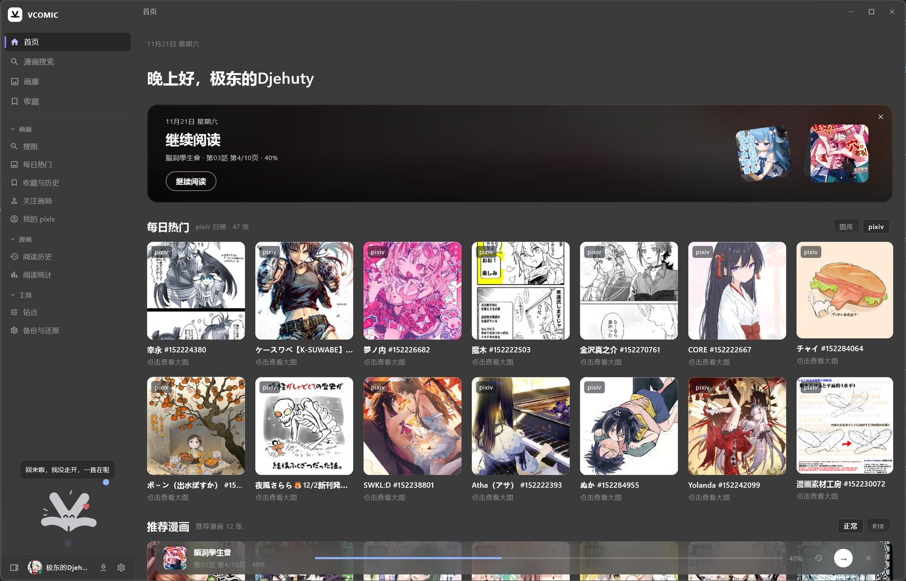
  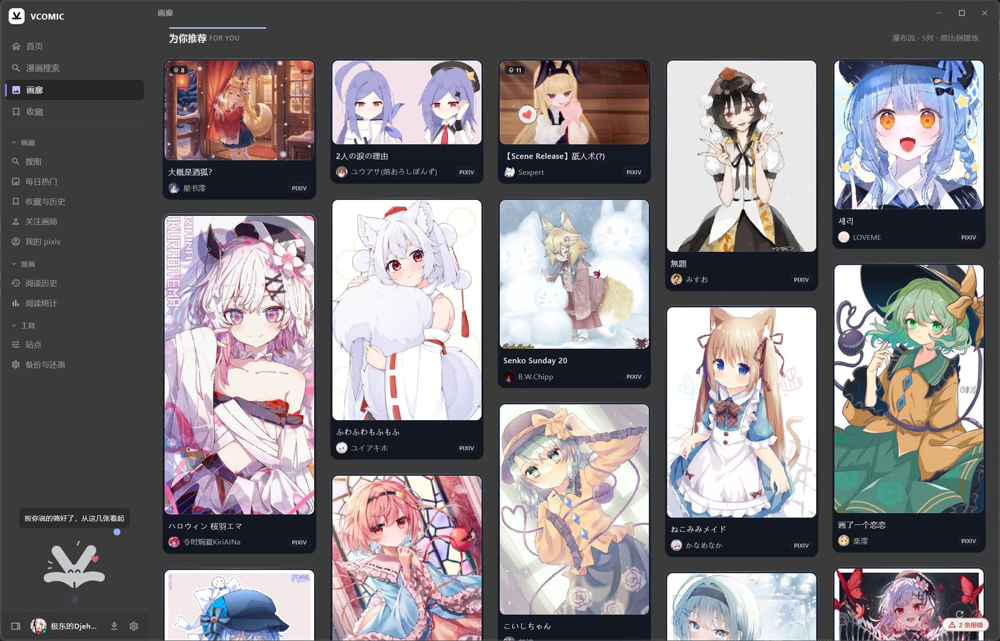
</p>
<p align="center">
  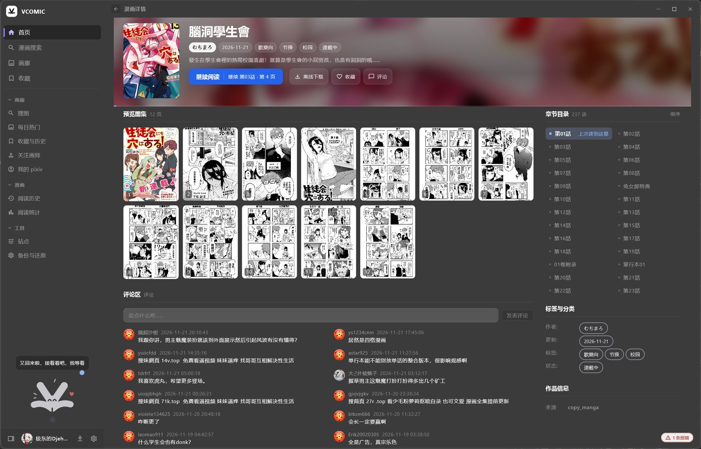
  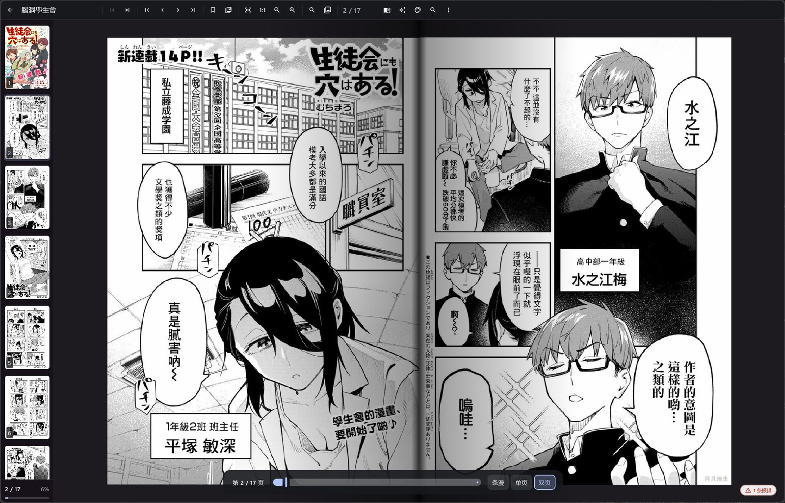
</p>
<p align="center">
  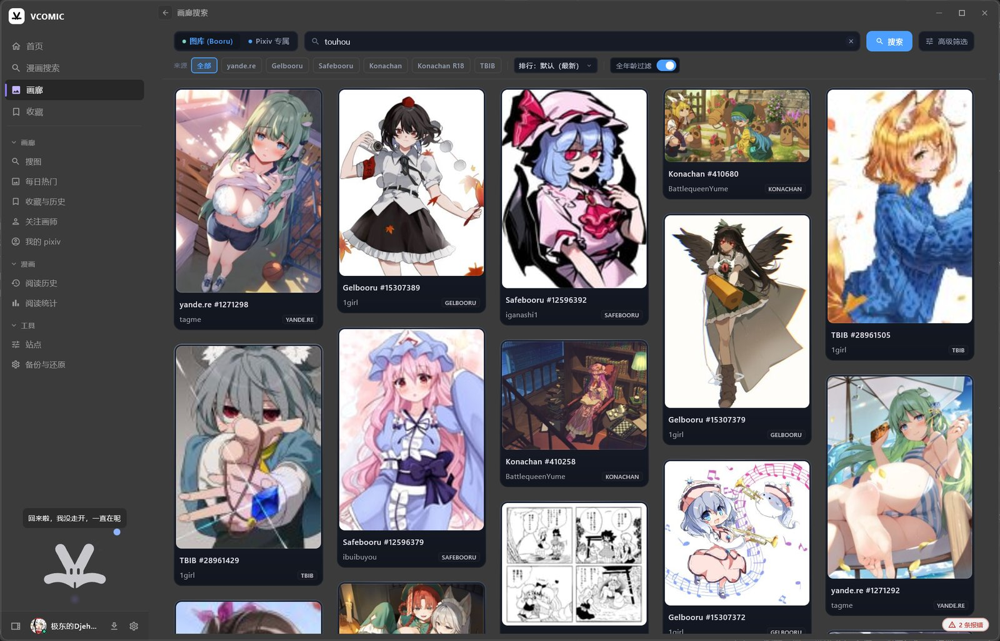
  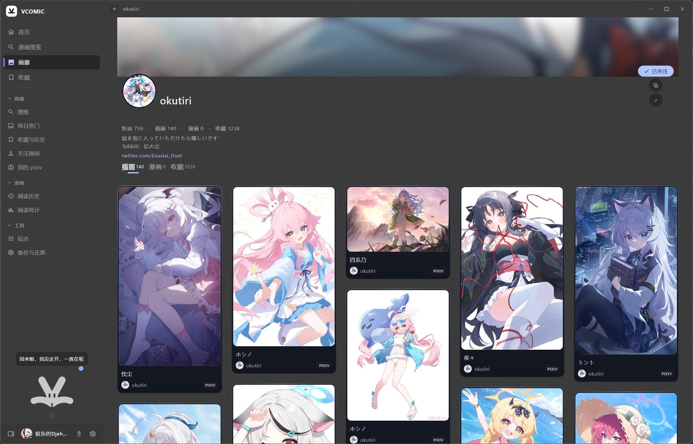
</p>
<p align="center">
  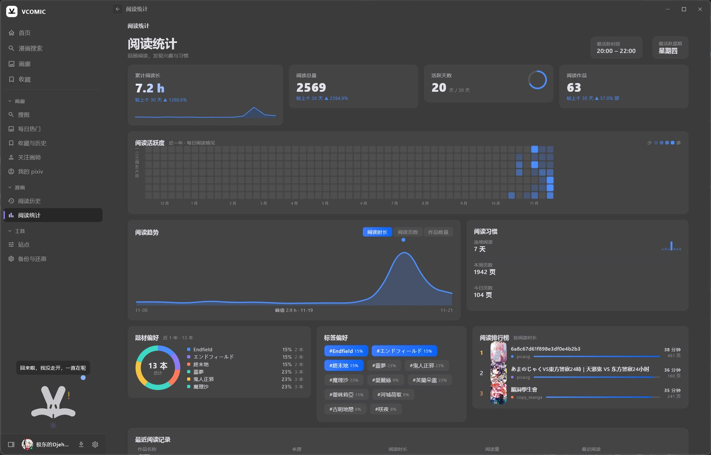
  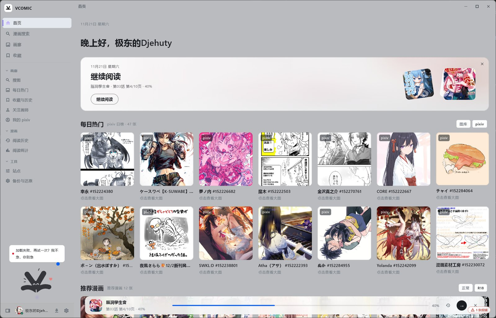
</p>

<p align="center"><sub>Home · Gallery wall · Manga detail · Reader · Gallery search · Artist profile · Reading stats · Light theme (captured on a development machine, compressed)</sub></p>

### Android app

<p align="center">
  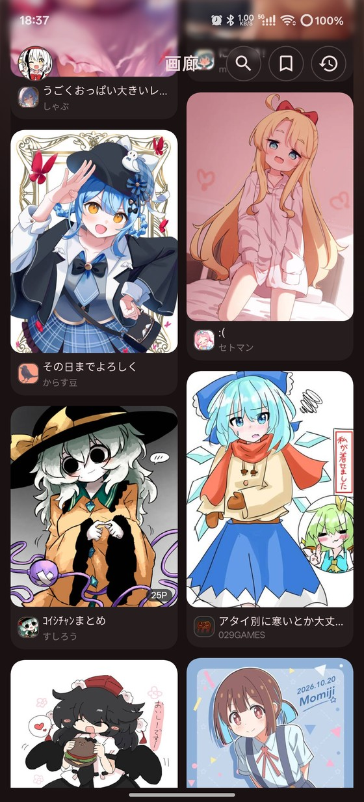
  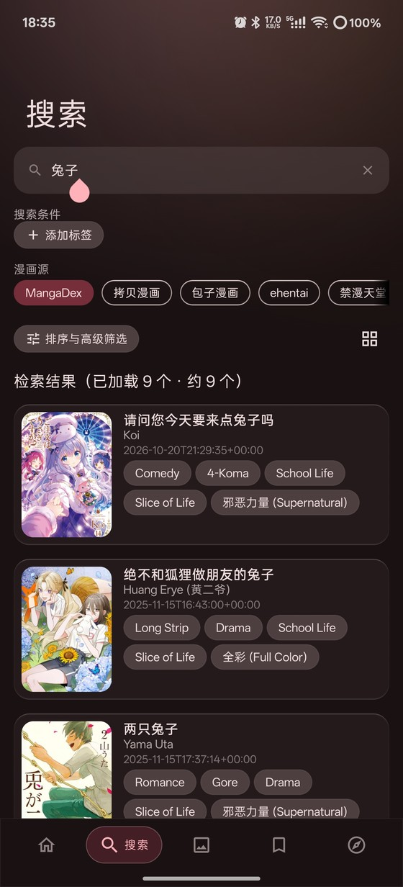
  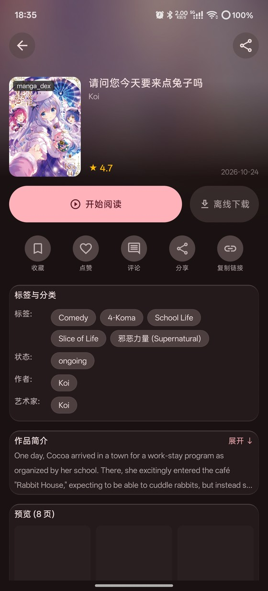
  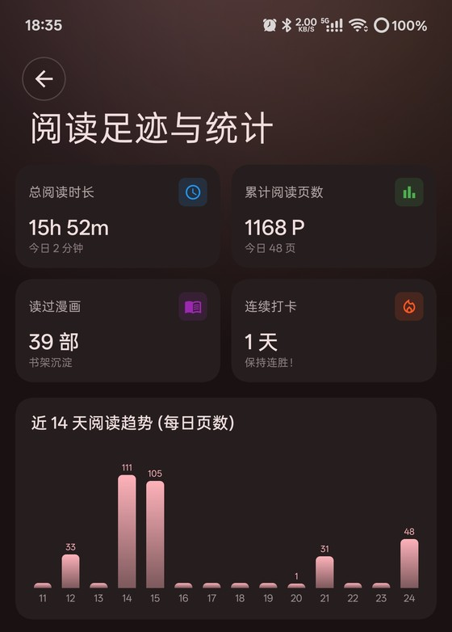
</p>

<p align="center"><sub>Gallery · Search · Manga detail · Reading stats (Miuix style)</sub></p>

### Official landing page

<p align="center">
  <a href="https://w13630039663-bit.github.io/Vcomic/#top">
    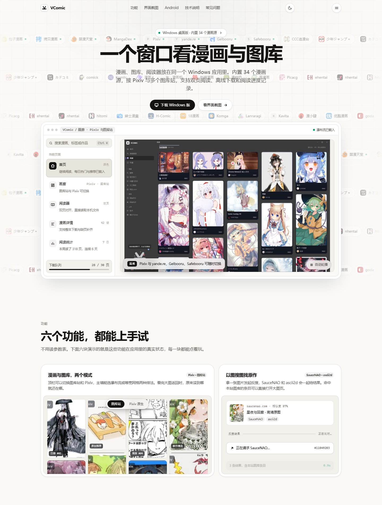
  </a>
</p>

<p align="center"><sub>Static landing page: hero window preview, six interactive feature demos, source wall and the Android showcase · <a href="https://w13630039663-bit.github.io/Vcomic/#top">Visit official website</a></sub></p>

---

## Desktop features

### 1. Manga explore, search and reading

- **Multi-source engine**: 34 JavaScript manga source scripts ship with the app (default enabled: `baozi`, `copy_manga`, `jm`, `manga_dex`). Supports category explore, rankings, single-source and aggregate search, plus local search-history suggestions.
- **Manga detail**: chapter list, synopsis, tags, related works, read-only paginated comments, a continue-reading capsule, and a follow button with four states (follow / followed / checking / reading).
- **Desktop reader**:
  - Four reading modes: continuous strip, two-page spread, Japanese right-to-left, Western left-to-right.
  - Input and navigation: wheel zoom (0.5x–4x), double-click zoom toggle, drag panning, keyboard shortcuts (`←`/`→`, `PageUp`/`PageDown`, `Home`/`End`, space and more), immersive mode, auto page turn, bookmarks and a magnifier.
  - Image processing: brightness, contrast, saturation, color temperature, monochrome and negative; plus despeckle, derasterize and upscale filters.

### 2. Follow-updates tracking

- **Dedicated ledger**: `venera_core.db` gains `comic_follow` and `comic_follow_sync_source` tables, so follow-updates accounts stay separate from favorites.
- **Dual-factor update detection**: total chapter count, latest chapter ID and non-empty title changes; falls back to the update timestamp when a source has no chapters. The first pass only builds a baseline, deleting chapters on the source does not trigger false positives, and new updates accumulate while the unread dot is still pending.
- **Follow center**: filter pills (all / updated / following / completed·paused / errored), serial check progress with a stop button, update-pinned cards ("up to chapter N, +M chapters"), per-title recheck / pause / mark completed / unfollow.
- **Bulk subscribe from website favorites**: a favorite folder can be added to or synced with follow-updates from the favorites toolbar, with paginated fetching, a 200-title per-run cap, two-step confirmation and a stop button at any time.
- **Check policy**: 1800ms per-source and 400ms cross-source throttling, a default 6-hour cooldown (6 / 12 / 24 hours), circuit breaking after three consecutive failures per source, and an optional "check on startup" setting.
- **Backup-aware**: both follow tables ride along with the favorites domain in full `.venera` backup and restore, in both overwrite and merge modes.

### 3. Favorites, history and statistics

- **Local and network favorites**: multiple custom folders, network favorites sync and a gallery favorites wall; local favorites support grid / two-column switching and a right-click "follow updates" action.
- **Gallery favorites wall**: grouped by site and artist, with a unified card entrance animation across the whole app (35ms stagger × max 6 steps, low-spring, fade + 14dp rise + 0.985 micro-scale).
- **Reading history**: a timeline of progress with source filtering, shelving marks and two-step clearing.
- **Reading statistics**: daily / weekly / streak stats, a 14-day trend, a Top 10 list and a reading heatmap.

### 4. Download queue and local library

- **Multi-thread queue**: multi-chapter queuing, FIFO scheduling, resume after restart, cooperative pause and resume, single-item removal and batch delete; image magic numbers (JPEG / PNG / GIF / WebP) are verified before writing to disk.
- **On-device downloads and offline reading**: per-chapter page counts and missing-page detection, gap filling and two-step safe deletion; fully downloaded chapters read straight from disk.
- **Local comics and image library**: local directory detection, CBZ / ZIP archive import and reading, and gallery images grouped by site and artist.

### 5. Gallery and Pixiv

- **Multi-site gallery**: yande.re, Gelbooru (requires account credentials) and Safebooru, with waterfall / justified grid switching, density and card size controls, rating filters, tag search and scroll position retention; opened posts are recorded in browsing history with a jump back to its card (fetches on demand; masked posts are not recorded).
- **Reverse image search and fullscreen viewer**: SauceNAO and ascii2d side by side; three quality tiers, zoom, an info drawer, and in-place video (requires VLC) and Ugoira playback, allowing you to save the current image to disk.
- **Pixiv**: PKCE callback, pasted link or token login; daily, weekly and monthly rankings; work detail; artist pages; the account feed and cloud bookmarks; cross-site artist and tag jumps between Pixiv and gallery sites.

### 6. Appearance, window and interaction

- **Window and materials**: built on the Nucleus window host, with dark, light and follow-system themes, Mica / Acrylic / solid backdrop switching, independent rail and top-bar blur toggles, and UI scaling from 80% to 150%.
- **Unified visual system**: transparent glass cards (two material tiers: `Primary` and `Nested`), a single input field (34dp, r8, 1dp outline, accent 2dp on focus), unified segmented controls and select boxes; every button has at least default / hover / pressed / focused / disabled states, plus a loading state for async actions.
- **Unified motion**: card entrances only use the `VeneraMotion` tools (`VeneraCardEnter` / `rememberCardEnterProgress`); page transitions only use the shared presets, with no ad-hoc durations, staggers or springs.
- **Card layout**: a dedicated "comic card layout" setting with adaptive or custom 1–6 rows × 1–8 columns, applied across all comic card pages.

### 7. Network, challenge bypass and safety

- **Networking**: HTTP / SOCKS5 proxies, image mirrors, download concurrency and custom naming templates.
- **Cloudflare bypass**: an Edge / CDP and WebView2 challenge bridge that handles cookies and user agent automatically. All jm domains (including `cdnhjk`, `cdngwc`, `cdn-msp` and `jcomic.net`) are on the bypass exemption list, and S3 presigned 403s are reported as expired signatures instead of misreported challenge blocks.
- **Content masking and blocking**: three-state content masking (none / cover blur / fully hidden), keyword / tag / artist / work-ID blocking rules and per-source content rating presets.

### 8. Data, feedback and system integration

- **Backup and sync**: full `.venera` archive export / restore (aligned with the Android format v5), legacy JSON import and WebDAV sync; the two-pane workspace supports selective import.
- **Errors and feedback**: a frosted error capsule at the top (filterable by all / comics / gallery / system, plain-language causes with a collapsible stack trace) and a persistent feedback entry in the title bar. Feedback can attach recent errors, pick local images or paste with `Ctrl+V`, and submitting copies a screenshot and opens a prefilled GitHub Issue.
- **System integration**: system tray, single-instance running and `pixiv://` / `venera://` protocol callbacks.
- **Custom installer**: a 7z SFX Mica-glass installer with real file copying, old MSI / Inno cleanup, shortcuts, HKCU uninstall registry entries and an "uninstall previous version" entry.

---

## Android features

> The Android build shares the same origin but has its own UI, built with the Miuix design language. Current version **2.1.5**; APKs are published in the mobile repository's Releases.

- **Two interface styles**: Material 3 (Android 12+ dynamic color) or HyperOS Miuix, with a floating liquid-glass bottom bar and dynamic blur.
- **Native gallery and Pixiv**: gallery-site / Pixiv dual-domain aggregation, daily / weekly / monthly rankings, native work and artist pages, cloud bookmarks and source-link sniffing jumps.
- **Reader**: strip / Japanese / Western / two-page spread / vertical continuous, pinch zoom, auto page turn, volume-key paging and night inversion; the new reader HUD adds bookmarks, a timer, a page jump and per-book mode.
- **Chapter and download panels**: an extended chapter directory sheet and a dual download sheet, with chapter multi-select, 1–16 threads, resume and fake-image verification.
- **Network engine**: automatic Cloudflare bypass, HTTP / SOCKS5 proxies, domain circuit breaking, DNS optimization, rate limiting and 29+ site deep links.
- **Favorites, history and follow-ups**: local / network favorites, background update notifications and reading stats with a 14-day curve.
- **Privacy**: three-state content masking, keyword / tag / artist / ID blocking and `FLAG_SECURE` screenshot protection.

---

## Download and install

### Windows desktop

Desktop packages are produced by this repository in two forms:

| Form | Output | Command |
|---|---|---|
| Mica installer | `VComic-<version>-setup.exe` | `.\gradlew.bat :desktop:packageSetupInstaller` |
| Portable folder | `desktop/build/compose/binaries/main/app/venera-desktop/` | `.\gradlew.bat :desktop:createDistributable` |

> Before an official release, build from source. The installer removes older MSI / Inno installations while keeping user data.

### Android

APKs are published for `universal`, `arm64-v8a`, `armeabi-v7a` and `x86_64`. Android 13 (API 33) or newer is required; see the mobile repository's Releases.

### Official landing page

The landing page is static HTML, hosted on GitHub Pages: **[https://w13630039663-bit.github.io/Vcomic/#top](https://w13630039663-bit.github.io/Vcomic/#top)** (`index.html` at the repository root references assets under `assets/`). To preview it locally, start any static server from the repository root (for example `python -m http.server 8080`) and open `index.html`.

---

## Requirements and quick start

Run all commands from the repository root `desktop/` (use `gradlew.bat` on Windows).

### Requirements

- **JDK 25**: the compile and run toolchain of `:desktop` (`jvmToolchain(25)`)
- **JDK 21**: the Gradle daemon runtime and `:engine-probe`
- **Gradle 9.7.1**: provided by the project wrapper, no separate install needed; toolchains download on demand
- **7-Zip (`7z.exe`)** (optional): only needed for `packageSetupInstaller`; `7zSD.sfx` is cached automatically
- **VLC** (optional): only used at runtime by `vlcj` when playing gallery videos

### Verify the environment and run in development

```powershell
# 1. Check the Gradle wrapper and daemon JDK
.\gradlew.bat --version

# 2. Incremental compile check
.\gradlew.bat :desktop:compileKotlin

# 3. Launch the desktop window in development
.\gradlew.bat :desktop:app

# 4. Launch the installer wizard standalone (optionally jump to a stage: SPLASH / OPTIONS / INSTALLING / COMPLETE)
.\gradlew.bat :desktop:installer -PinstallerPage=OPTIONS
```

You can also double-click `run-venera.bat` in the repository root for an interactive menu that starts the app, opens a specific page or runs tests.

---

## Tests and packaging

```powershell
# Run the full unit test suite (current baseline is about 1700+ tests; see docs/01-product/roadmap.md for test records)
.\gradlew.bat :desktop:test

# Run a single test class
.\gradlew.bat :desktop:test --tests com.venera.desktop.architecture.DesktopUiIsolationTest

# Duplicate-import check (already wired into :desktop:check)
.\gradlew.bat :desktop:checkDuplicateImports

# Summarize the latest test results
node _tools/count_desktop_tests.js

# Build a portable app directory
.\gradlew.bat :desktop:createDistributable

# Build a Windows MSI installer
.\gradlew.bat :desktop:packageMsi

# Build the custom Mica installer
.\gradlew.bat :desktop:packageSetupInstaller
```

---

## Directory layout

The project uses a four-layer, single-direction architecture. All source lives inside two Gradle modules, `:desktop` and `:engine-probe`:

```text
desktop/
├── build.gradle.kts                  # Root build configuration
├── settings.gradle.kts               # Module declarations (:desktop, :engine-probe)
├── gradle.properties                 # JVM memory and build property settings
├── gradle/libs.versions.toml         # Central dependency version catalog
├── index.html                        # Official landing page (references website/assets)
├── run-venera.bat                    # Interactive Windows launcher and test menu
├── _tools/                           # Helper tools (e.g. count_desktop_tests.js)
├── scripts/                          # Build helper scripts (e.g. enable-segment-heap.ps1)
├── docs/                             # Project docs (architecture, database, guides, designs, screenshots)
│   └── images/                       # README screenshots (desktop / android / website)
├── engine-probe/                     # [L3 engine · JDK 21] QuickJS host, EngineSession, cookie jar, JS handlers
└── desktop/                          # [L0-L2 application · JDK 25]
    ├── build.gradle.kts              # Desktop packaging and runtime JVM arguments
    ├── packaging/                    # Windows app icon (vcomic-icon.ico, etc.)
    └── src/
        ├── main/
        │   ├── kotlin/com/venera/
        │   │   ├── desktop/          # [L0/L1] entry point (VeneraDesktop.kt), window host, UI, platform implementations
        │   │   └── compose/          # [L2] shared foundation (BusinessPorts, platform contracts, DB schema, shared UI)
        │   └── resources/
        │       ├── sources/          # 34 bundled JS manga source scripts
        │       ├── venera-init.js    # JS engine init script
        │       ├── venera-shim.js    # JS engine shim script
        │       ├── source_content_warning.json  # Per-source content rating presets
        │       └── gallery_tags_79415.sqlite    # Offline gallery tag dictionary
        ├── probe/kotlin/com/venera/desktop/     # Debug probe entry (excluded from the installer)
        └── test/kotlin/com/venera/desktop/      # Unit tests, UI semantics tests and architecture isolation tests
```

### Architecture boundaries

- **Single-direction dependency**: the dependency direction is strictly `desktop` → `compose` and `desktop` → `engineprobe`. The `compose` layer must never reference `desktop` or `engineprobe`, guarded by `DesktopUiIsolationTest` and `DesktopNoAndroidImportTest`.
- **Ports and side-effect isolation**: the business boundary is `BusinessPorts` (17 port groups) implemented by `DesktopBusinessPorts`; the desktop side never calls `BusinessPorts.of`. Toasts, clipboard, sharing and cover-masking state all go through `LocalUxPlatformServices`.

---

## Configuration and extension

### 1. Data directory and persistence

The app starts without network access. All local data and run logs live under the Windows user data root:

- **Data root**: `%LOCALAPPDATA%\venera\`
- **Run log**: `%LOCALAPPDATA%\venera\logs\venera-<pid>-<time>.log` (packaged builds hide the console; all debug output goes here)
- **SQLite databases** under `%LOCALAPPDATA%\venera\db\`:
  - `venera_core.db`: reading history, core favorites, reading stats, image favorites, content guard rules and follow-updates ledgers
  - `local_favorite.db`: local custom favorite folders and their bindings

### 2. Manga source plugins

Manga sources run on the QuickJS host through a JavaScript plugin protocol:

- **Bundled sources**: `desktop/desktop/src/main/resources/sources/*.js`
- **Management**: the in-app "Sources" screen can enable or disable bundled sources, reorder them by drag, edit a script override layer, import external JS sources, and configure source accounts or cookie credentials.

### 3. Common launch and build flags

The following Gradle properties can be attached to `.\gradlew.bat :desktop:app` (some are also accepted as environment variables or through `run-venera.bat`):

| Flag | Description | Example |
|---|---|---|
| `-Pproxy=<host:port>` | Network proxy (or the `VENERA_PROXY` environment variable) | `-Pproxy=127.0.0.1:7890` |
| `-Pkey=<source_key>` | Default manga source at launch (`jm` by default) | `-Pkey=copy_manga` |
| `-PstartDomain=<DOMAIN>` | Start in a given domain (`GALLERY`/`DISCOVER`/`SEARCH`/`FAVORITES`/`ARTISTS`/`COMIC`/`SETTINGS`) | `-PstartDomain=GALLERY` |
| `-Popen=<PAGE>` | Open a secondary page directly (e.g. `QUEUE`/`DOWNLOADS`/`HISTORY`/`SOURCES`/`SETTINGS`) | `-Popen=SETTINGS` |
| `-Pdesktop.dwmsbt=<N>` | Override the Windows DWM backdrop (`2`=Mica, `3`=Acrylic, `4`=MicaAlt; default `3`) | `-Pdesktop.dwmsbt=2` |
| `-Pshot=<path.png>` | Capture the window once rendering settles, then exit | `-Pshot=screenshots/out.png` |
| `-PskipEngineProbe` | Skip the slow engine concurrency test class when running tests (daily iteration only, not a substitute for the full suite) | `.\gradlew.bat :desktop:test -PskipEngineProbe` |
| `-PinnoSetupHome=<path>` | Point to an Inno Setup installation directory (also settable as `innoSetupHome` in `gradle.properties`) | `-PinnoSetupHome=D:\Tools\InnoSetup` |

---

## License and acknowledgements

- Released under the [GNU General Public License v3.0](LICENSE).
- Thanks to the [Venera](https://github.com/venera-app/venera) authors and community for the manga source plugin protocol and ecosystem.
- Miuix controls and icons on the desktop side come from Miuix KMP (`top.yukonga.miuix.kmp`).
