<div align="center">


# VComic（漫画与图库）

**一个窗口，看漫画与图库。**

Windows 桌面端多源漫画阅读器 + 多站图库浏览器。<br/>
内置 34 个 JavaScript 漫画源，接入 Pixiv 与多个图库站，提供双页阅读、离线下载、漫画追更与阅读统计。

[](desktop/build.gradle.kts)
[](https://w13630039663-bit.github.io/Vcomic/#top)
[](gradle/libs.versions.toml)
[](gradle/libs.versions.toml)
[](#环境要求与快速启动)
[](LICENSE)

**简体中文** | [English](README.en.md)

[官方网站](https://w13630039663-bit.github.io/Vcomic/#top) · [界面预览](#界面预览) · [核心功能](#桌面版核心功能) · [下载与安装](#下载与安装) · [从源码构建](#环境要求与快速启动)

</div>

---

## 这是什么

VComic 是一个多端漫画与图库项目，目前包含三部分：

| 端 | 说明 | 形态 |
|---|---|---|
| **Windows 桌面版**（本仓库） | Kotlin + Compose Multiplatform 原生单窗口应用，UI 与业务全部桌面自持 | `.exe` 安装器 / 便携目录 |
| **Android 手机版** | Miuix + Material 3 双风格的移动端实现，与桌面版同源、UI 各自独立 | APK（Android 13+） |
| **官方宣传页** | 静态 HTML 宣传页，含交互式功能演示 | [在线访问](https://w13630039663-bit.github.io/Vcomic/#top) / `index.html` |

桌面版本体已移除原 Android `:app` 模块与源码映射，使用内置 QuickJS 引擎执行漫画源插件；数据格式与手机版保持兼容，`.venera` 备份可以跨端导入导出。

---

## 界面预览

### Windows 桌面版

<p align="center">
  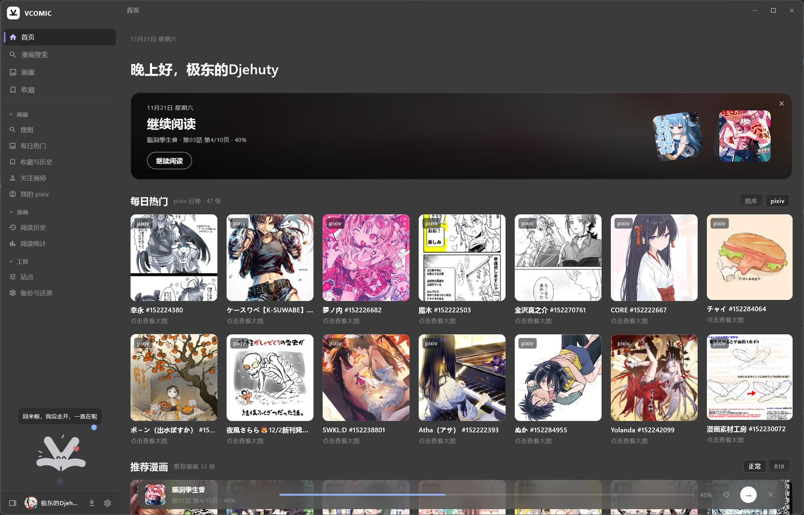
  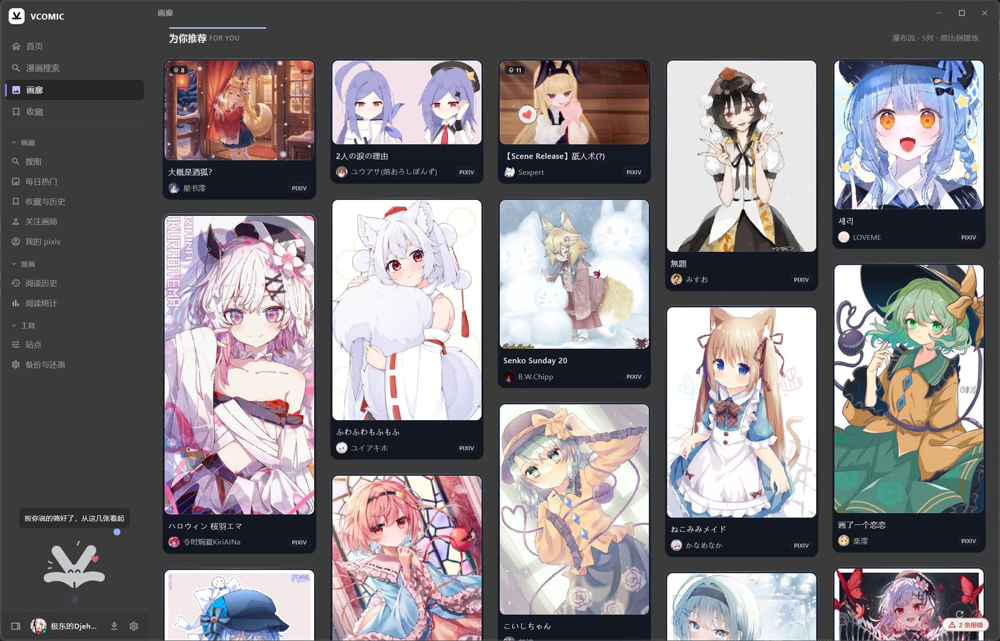
</p>
<p align="center">
  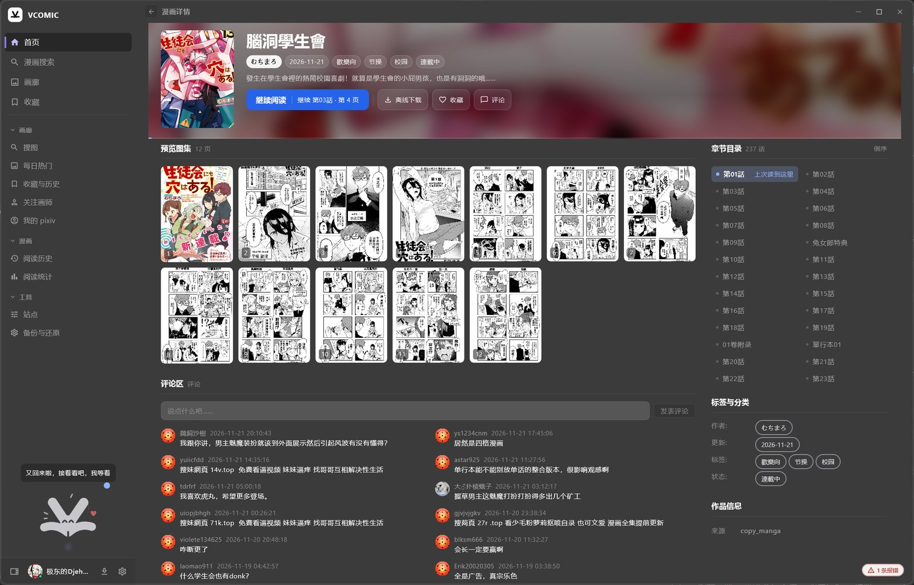
  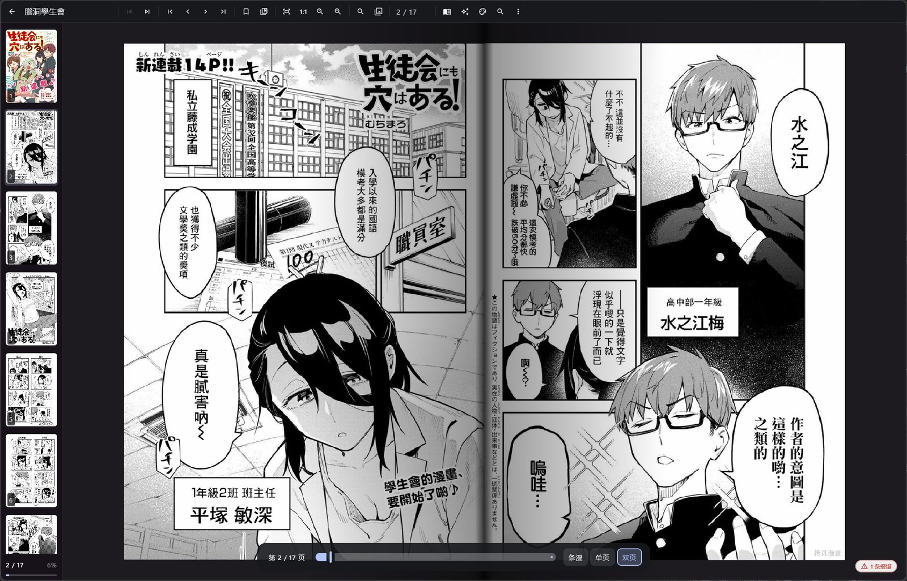
</p>
<p align="center">
  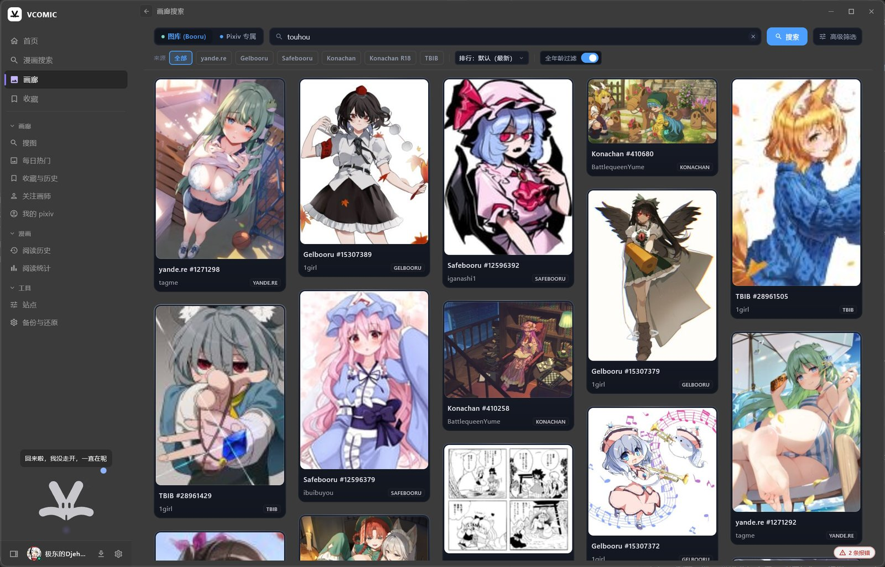
  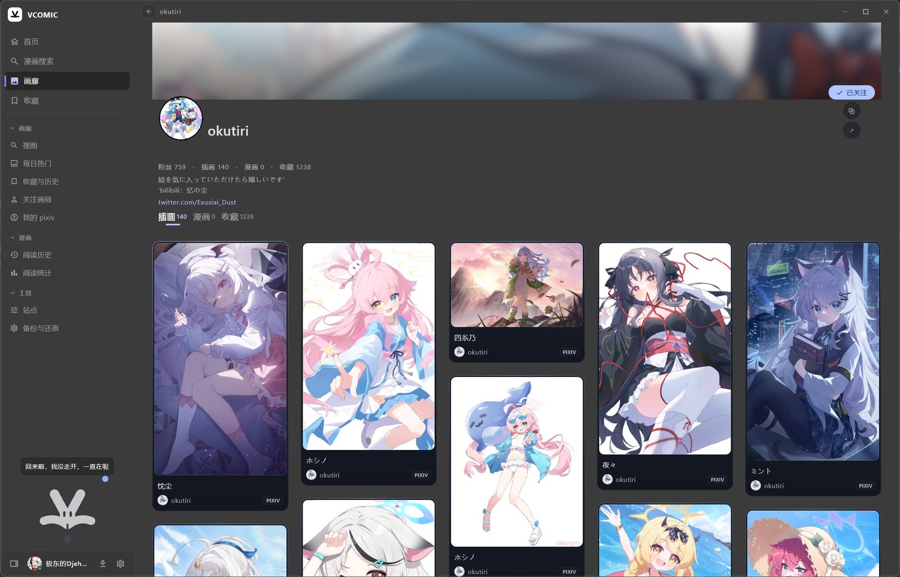
</p>
<p align="center">
  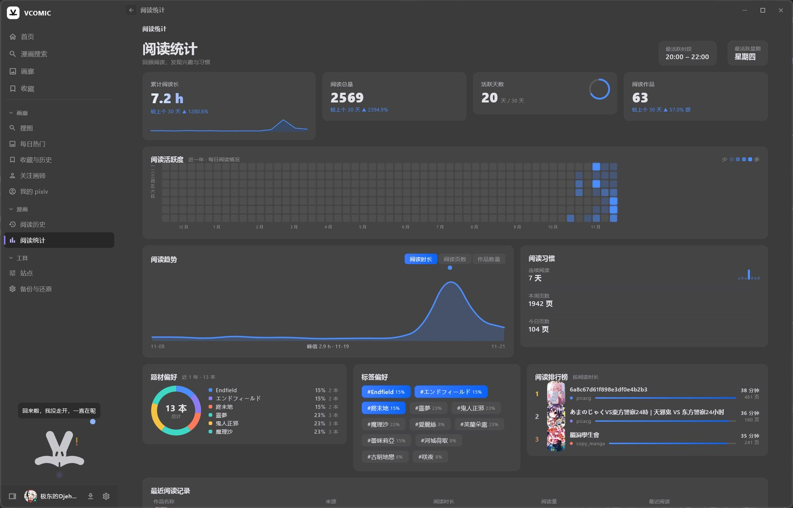
  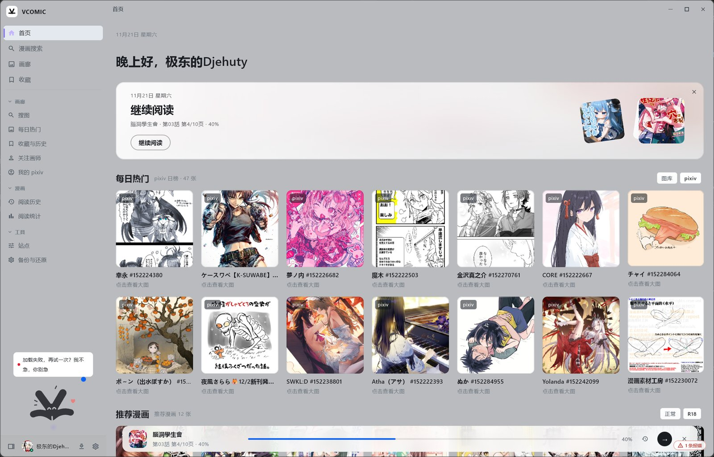
</p>

<p align="center"><sub>首页 · 图库主墙 · 漫画详情 · 阅读器 · 图库搜索 · 画师主页 · 阅读统计 · 浅色主题（开发机实拍，已压缩）</sub></p>

### Android 手机版

<p align="center">
  
  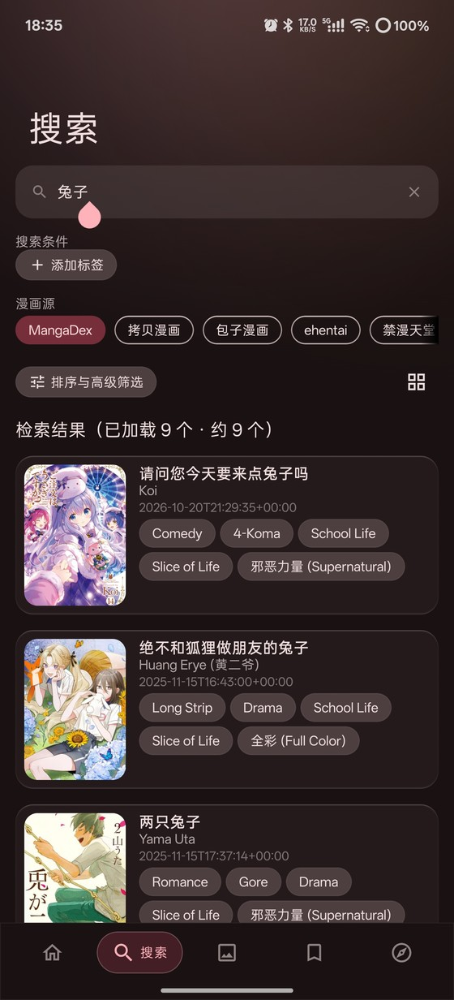
  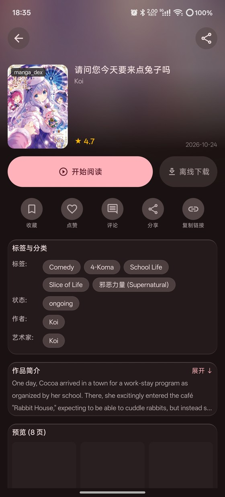
  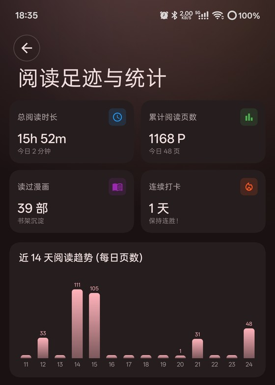
</p>

<p align="center"><sub>画廊 · 搜索探索 · 漫画详情 · 阅读统计（Miuix 风格）</sub></p>

### 官方网站

<p align="center">
  <a href="https://w13630039663-bit.github.io/Vcomic/#top">
    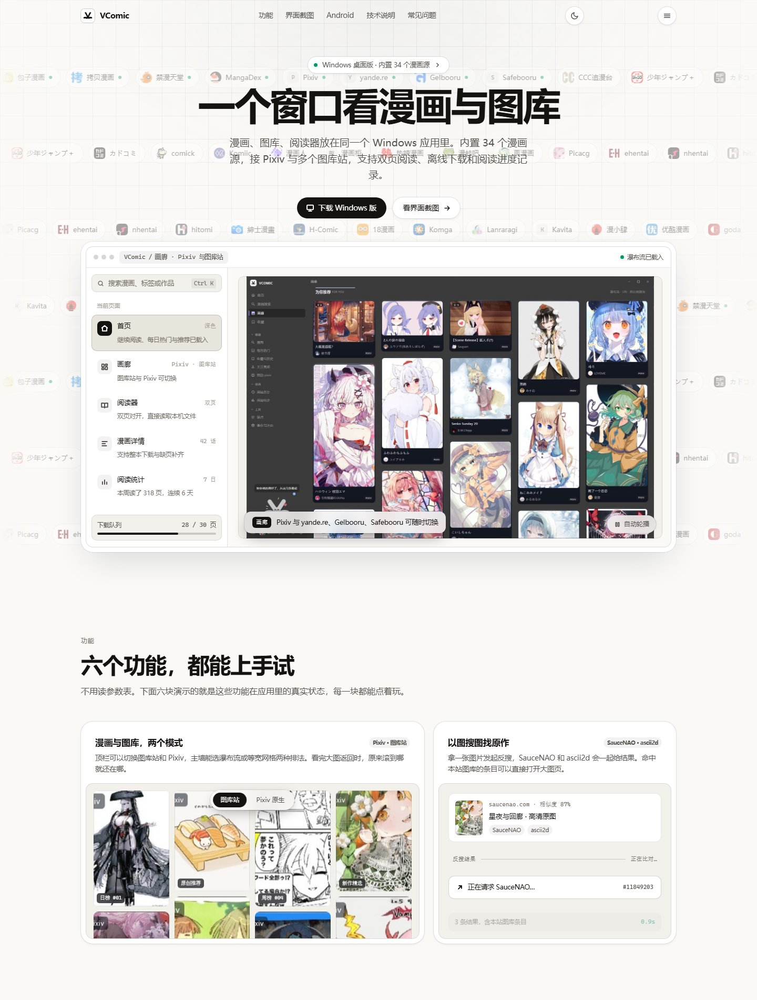
  </a>
</p>

<p align="center"><sub>静态宣传页：首屏桌面窗口预览、六块可交互功能演示、来源墙与 Android 双端展示 · <a href="https://w13630039663-bit.github.io/Vcomic/#top">立即访问官方网站</a></sub></p>

---

## 桌面版核心功能

### 1. 漫画探索、搜索与阅读

- **多源漫画引擎**：随包内置 34 个 JavaScript 漫画源脚本（默认启用 `baozi`、`copy_manga`、`jm`、`manga_dex`），支持分类探索、排行榜、单源/多源聚合搜索与本地搜索历史联想。
- **漫画详情**：章节列表、简介、标签、相关推荐、只读分页评论、继续阅读进度胶囊，以及「追更」按钮（追更 / 已追更 / 正在写 / 正在读四档状态）。
- **桌面阅读器**：
  - 四档阅读模式：条漫连续、对开双页、日漫（右至左）、美漫（左至右）。
  - 交互与导航：滚轮缩放（0.5x–4x）、双击缩放往返、拖拽平移、键盘快捷键（方向键、`PageUp`/`PageDown`、`Home`/`End`、空格等）、沉浸模式、自动翻页、书签与放大镜。
  - 画面处理：亮度 / 对比度 / 饱和度 / 色温 / 黑白 / 负片调节，以及去痕、去网纹与超分滤镜。

### 2. 漫画追更

- **独立追更账本**：`venera_core.db` 新增 `comic_follow` 与 `comic_follow_sync_source` 两表，追更与收藏分开记账。
- **双因子更新判定**：总话数、末话 ID、非空标题变化三路判断，无章节时回退更新时间；首轮只建基线不误报，源删章不误报，未读红点未消时新更累加。
- **追更中心**：筛选胶囊（全部 / 有更新 / 追更中 / 已完结·暂停 / 异常）、串行巡检进度与「停止检查」、更新置顶卡片（更新至第 N 话 +M 话）、单本重查 / 暂停恢复 / 标完结 / 取消追更。
- **网站收藏批量订阅**：收藏页顶栏可把整个收藏夹「加入追更 / 同步追更」，分页拉取、单次上限 200 本、两段式确认、随时停止。
- **巡检策略**：同源 1800ms、跨源 400ms 节流，默认 6 小时冷却（可调 6 / 12 / 24 小时），同源连续 3 次失败熔断本轮，支持设置页「启动时自动检查」。
- **随备份迁移**：追更两表随「收藏」域进入整包 `.venera` 备份与恢复，覆盖与合并两档都支持。

### 3. 收藏、历史与统计

- **本地与网络双收藏**：多自定义收藏夹、网络收藏同步、画廊收藏墙；本地收藏支持「网格 / 双列」视图切换与右键「加入追更」。
- **画廊收藏墙**：按站点与画师分组，卡片入场动画全站统一（错峰 35ms × 上限 6 档、低弹弹簧、淡入 + 上浮 14dp + 0.985 微缩放）。
- **阅读历史**：按时间轴记录进度，支持按源筛选、搁置标记与两步清空。
- **阅读统计**：今日 / 本周 / 连续阅读、近 14 天趋势、Top 10 与阅读热力图。

### 4. 下载队列与本地书架

- **多线程队列管理**：多章节排队、FIFO 调度、重启续排、协作式暂停 / 恢复、单笔移除与批量删除；落盘前校验图像魔数头部（JPEG / PNG / GIF / WebP）。
- **本机已下载与离线阅读**：按话校验本地页数与缺页状态，支持缺页补齐与两步安全删除；完整章节离线直接从磁盘读取。
- **本地漫画与图片库**：本地目录识别、CBZ / ZIP 归档导入阅读，图库本地图片按站点与画师分组管理。

### 5. 图库与 Pixiv

- **多站图库聚合**：支持 yande.re、Gelbooru（需配置账号凭据）、Safebooru 等站点，提供瀑布流 / 等宽网格切换、密度与卡片大小调节、安全分级过滤、标签搜索与滚动位置保留；点开的帖子记入浏览历史并支持回原卡（按下现取，被屏蔽的帖子不记）。
- **以图搜图与全屏看图**：SauceNAO 与 ascii2d 同屏反搜；看图器支持画质三档切换、缩放、信息抽屉、视频（需本机安装 VLC）与 Ugoira 动图就地播放，可将当前图片保存到本地。
- **Pixiv 接入**：PKCE 回跳 / 链接 / Token 三种登录方式，日 / 周 / 月榜、作品详情、画师主页、账号动态与云端收藏，以及与图库站之间的画师 / 标签跨站跳转。

### 6. 外观、窗口与交互

- **窗口与材质**：基于 Nucleus 窗口宿主，支持深色 / 浅色 / 跟随系统主题，Mica / Acrylic / 实底材质切换，侧栏与顶栏独立模糊开关，界面缩放 80%–150%。
- **统一视觉体系**：全站透明玻璃卡片（`Primary` / `Nested` 两级材质）、统一输入场（34dp / r8 / 1dp 描边，聚焦转 accent 2dp）、统一切换器与选择框；按钮至少默认 / 悬停 / 按压 / 焦点 / 禁用五态，异步动作另加加载态。
- **动效统一**：卡片入场只认 `VeneraMotion` 标准工具（`VeneraCardEnter` / `rememberCardEnterProgress`），页面转场只认统一预设，禁止散写时长、错峰与弹簧。
- **卡片布局**：新增独立「漫画卡片布局」设置，自适应或自定义 1–6 行 × 1–8 列，全站漫画卡片页面统一接入。

### 7. 网络、过盾与安全

- **网络能力**：HTTP / SOCKS5 代理、图床反代、下载并发控制、自定义命名模板。
- **Cloudflare 过盾**：基于 Edge / CDP 与 WebView2 的挑战桥接，自动处理 Cookie 与 UA；jm 全族域名（含 `cdnhjk`、`cdngwc`、`cdn-msp`、`jcomic.net`）在过盾豁免名单内，S3 预签名 403 单独提示签名过期而非误报撞盾。
- **内容遮罩与屏蔽**：三态内容遮罩（无过滤 / 封面打码 / 彻底隐藏）、关键词 / 标签 / 画师 / 作品 ID 屏蔽规则、源级内容分级预设。

### 8. 数据、反馈与系统集成

- **备份与同步**：整包 `.venera` 归档导出 / 还原（与手机版格式 v5 对齐）、旧版 JSON 兼容导入、WebDAV 同步；双栏工作台支持分项勾选导入。
- **报错与反馈**：顶部透明磨砂报错胶囊（按全部 / 漫画 / 图库 / 系统筛选，大白话原因 + 可折叠技术栈），顶栏常驻反馈入口，支持关联最近报错、本地选图与 `Ctrl+V` 贴图，提交时自动复制截图并跳转 GitHub 预填 Issue。
- **系统集成**：系统托盘、单实例运行、`pixiv://` 与 `venera://` 协议回传。
- **自研安装器**：7z SFX 云母玻璃安装向导，支持真实文件复制、旧版 MSI / Inno 清理、快捷方式、HKCU 卸载注册表与「卸载原程序」入口。

---

## 手机版核心功能

> Android 版为同源分支，UI 采用 Miuix 设计语言，与桌面版各自独立。当前版本 **2.1.5**，APK 见手机端仓库 Releases。

- **双风格界面**：Material 3（Android 12+ 动态取色）与 HyperOS Miuix 随心切换，液态悬浮玻璃底栏与动态毛玻璃。
- **画廊与 Pixiv 原生生态**：图库站 / Pixiv 双域聚合、日周月榜、原生作品页与画师页、账号云端书签、来源嗅探直跳。
- **阅读器**：画卷 / 日漫 / 美漫 / 双页横折 / 竖屏连续，双指缩放、自动翻页、音量键翻页、夜间反色；新版阅读 HUD 支持书签、定时、跳页与按本模式。
- **章节与下载面板**：超多章节目录面板、下载双面板，支持章节级多选、1–16 线程、断点续传与假图校验。
- **网络引擎**：Cloudflare 自动过盾、HTTP / SOCKS5 代理、域名熔断、DNS 优选、限速防封、29+ 站点深链。
- **收藏、历史与追更**：本地 / 网络双收藏、后台追更通知、阅读统计与 14 天曲线。
- **隐私**：三态内容遮罩、关键词 / 标签 / 画师 / ID 屏蔽、`FLAG_SECURE` 防截图。

---

## 下载与安装

### Windows 桌面版

桌面版安装包由本仓库构建产出，当前提供两种形态：

| 形态 | 产物 | 生成命令 |
|---|---|---|
| 云母安装器 | `VComic-<版本>-setup.exe` | `.\gradlew.bat :desktop:packageSetupInstaller` |
| 便携目录 | `desktop/build/compose/binaries/main/app/venera-desktop/` | `.\gradlew.bat :desktop:createDistributable` |

> 正式发布前请从源码构建；安装器会清理旧版 MSI / Inno 安装并保留用户数据。

### Android 手机版

APK 提供 `universal`、`arm64-v8a`、`armeabi-v7a`、`x86_64` 四种 ABI，系统要求 Android 13（API 33）及以上，发布在手机端仓库 Releases。

### 官方网站

宣传页为静态 HTML，已托管至 GitHub Pages：**[https://w13630039663-bit.github.io/Vcomic/#top](https://w13630039663-bit.github.io/Vcomic/#top)**，仓库根目录 `index.html` 引用同级 `assets/` 素材。本地预览时在仓库根目录启动任意静态服务器（例如 `python -m http.server 8080`）后访问 `index.html` 即可。

---

## 环境要求与快速启动

所有命令均在仓库根目录 `desktop/` 下执行（Windows 下使用 `gradlew.bat`）。

### 环境要求

- **JDK 25**：`:desktop` 模块编译与运行工具链（`jvmToolchain(25)`）
- **JDK 21**：`:engine-probe` 模块与 Gradle Daemon 运行环境
- **Gradle 9.7.1**：由项目内 Gradle Wrapper 提供，无需单独安装，Toolchain 可按需自动下载
- **7-Zip（`7z.exe`）**（可选）：仅执行 `packageSetupInstaller` 生成自研安装器时需要，`7zSD.sfx` 由构建按需缓存
- **VLC**（可选）：仅图库视频播放时由 `vlcj` 运行期调用

### 校验环境与开发态运行

```powershell
# 1. 校验 Gradle Wrapper 与 Daemon JDK
.\gradlew.bat --version

# 2. 增量编译检查
.\gradlew.bat :desktop:compileKotlin

# 3. 启动桌面应用窗口（开发态）
.\gradlew.bat :desktop:app

# 4. 启动安装向导独立窗口（可直达某一态：SPLASH / OPTIONS / INSTALLING / COMPLETE）
.\gradlew.bat :desktop:installer -PinstallerPage=OPTIONS
```

也可以直接双击根目录下的 `run-venera.bat`，通过交互式菜单启动应用、预览指定页面或执行测试。

---

## 测试与打包

```powershell
# 运行全量单元测试（当前基线约 1700+ 项，测试记录见 docs/01-product/roadmap.md）
.\gradlew.bat :desktop:test

# 点名运行指定测试类
.\gradlew.bat :desktop:test --tests com.venera.desktop.architecture.DesktopUiIsolationTest

# 重复引入检查（:desktop:check 已自动依赖）
.\gradlew.bat :desktop:checkDuplicateImports

# 统计最近一次测试结果
node _tools/count_desktop_tests.js

# 生成免安装可运行目录
.\gradlew.bat :desktop:createDistributable

# 打包为 Windows MSI 安装包
.\gradlew.bat :desktop:packageMsi

# 打包为自研云母安装器
.\gradlew.bat :desktop:packageSetupInstaller
```

---

## 目录结构说明

项目采用四层单向依赖架构，全部源码位于 `:desktop` 与 `:engine-probe` 两个 Gradle 模块内：

```text
desktop/
├── build.gradle.kts                  # 根构建配置
├── settings.gradle.kts               # 模块声明（:desktop, :engine-probe）
├── gradle.properties                 # JVM 内存与构建属性配置
├── gradle/libs.versions.toml         # 统一依赖版本目录
├── index.html                        # 官方网站宣传页（引用 website/assets）
├── run-venera.bat                    # Windows 交互式启动与测试菜单脚本
├── _tools/                           # 辅助工具脚本（如测试计数 count_desktop_tests.js）
├── scripts/                          # 构建辅助脚本（如 enable-segment-heap.ps1）
├── docs/                             # 项目文档（架构、数据库、构建指南、设计稿、截图）
│   └── images/                       # README 截图（桌面 / android / website）
├── engine-probe/                     # [L3 引擎层 · JDK 21] QuickJS 宿主、EngineSession、Cookie 罐、JS Handler
└── desktop/                          # [L0-L2 应用层 · JDK 25]
    ├── build.gradle.kts              # 桌面应用打包与运行时 JVM 参数配置
    ├── packaging/                    # Windows 应用图标（vcomic-icon.ico 等）
    └── src/
        ├── main/
        │   ├── kotlin/com/venera/
        │   │   ├── desktop/          # [L0/L1] 进程入口（VeneraDesktop.kt）、窗口宿主、桌面 UI、平台实现与端口适配器
        │   │   └── compose/          # [L2] 公共基建（BusinessPorts 端口、平台契约、DB Schema、共享组件与画廊域）
        │   └── resources/
        │       ├── sources/          # 随包分发的 34 个 JS 漫画源脚本
        │       ├── venera-init.js    # JS 引擎初始化脚本
        │       ├── venera-shim.js    # JS 引擎垫片脚本
        │       ├── source_content_warning.json  # 源级内容分级预设
        │       └── gallery_tags_79415.sqlite    # 离线图库标签词典
        ├── probe/kotlin/com/venera/desktop/     # 调试探针入口（不进安装包，经 probe 源集编译）
        └── test/kotlin/com/venera/desktop/      # 单元测试、UI 语义测试与架构隔离测试
```

### 架构边界约定

- **单向依赖**：依赖方向严格为 `desktop` → `compose` 与 `desktop` → `engineprobe`。`compose` 公共层禁止反向引用 `desktop` 或 `engineprobe`，由 `DesktopUiIsolationTest` 与 `DesktopNoAndroidImportTest` 守护。
- **端口与副作用隔离**：业务边界通过 `BusinessPorts`（17 组端口）与 `DesktopBusinessPorts` 对接（桌面端禁用 `BusinessPorts.of`）；Toast、剪贴板、分享与封面打码状态统一通过 `LocalUxPlatformServices` 注入。

---

## 配置与扩展方式

### 1. 数据目录与持久化存储

应用默认不联网启动，所有本地数据与运行日志均存放在 Windows 用户数据根目录下：

- **数据根目录**：`%LOCALAPPDATA%\venera\`
- **运行日志**：`%LOCALAPPDATA%\venera\logs\venera-<pid>-<时间>.log`（打包版关闭控制台窗口，调试输出统一写入此文件）
- **SQLite 数据库**（位于 `%LOCALAPPDATA%\venera\db\`）：
  - `venera_core.db`：阅读历史、核心收藏、阅读统计、插图收藏、屏蔽规则与追更账本
  - `local_favorite.db`：本地自定义收藏夹与绑定关系

### 2. 漫画源插件扩展

漫画源基于 JavaScript 插件协议运行于 QuickJS 宿主中：

- **内置源路径**：`desktop/desktop/src/main/resources/sources/*.js`
- **管理与扩展**：应用内「源管理」页面可启停内置源、拖拽排序、在线编辑脚本覆盖层、导入外部 JS 源脚本，或配置源账号与 Cookie 凭据。

### 3. 常用启动与构建参数

执行 `.\gradlew.bat :desktop:app` 时可附加以下 Gradle 属性（部分参数也可通过环境变量或 `run-venera.bat` 传递）：

| 参数 | 说明 | 示例 |
|---|---|---|
| `-Pproxy=<host:port>` | 指定网络代理（或设置环境变量 `VENERA_PROXY`） | `-Pproxy=127.0.0.1:7890` |
| `-Pkey=<source_key>` | 指定启动时使用的默认漫画源（默认 `jm`） | `-Pkey=copy_manga` |
| `-PstartDomain=<DOMAIN>` | 启动后落入指定功能域（`GALLERY`/`DISCOVER`/`SEARCH`/`FAVORITES`/`ARTISTS`/`COMIC`/`SETTINGS`） | `-PstartDomain=GALLERY` |
| `-Popen=<PAGE>` | 启动直达指定二级页（如 `QUEUE`/`DOWNLOADS`/`HISTORY`/`SOURCES`/`SETTINGS` 等） | `-Popen=SETTINGS` |
| `-Pdesktop.dwmsbt=<N>` | 覆盖 Windows DWM 窗口背景材质（`2`=Mica、`3`=Acrylic、`4`=MicaAlt，默认 `3`） | `-Pdesktop.dwmsbt=2` |
| `-Pshot=<path.png>` | 启动渲染稳定后自动截取当前窗口并退出 | `-Pshot=screenshots/out.png` |
| `-PskipEngineProbe` | 跑测试时跳过耗时的引擎并发测试类（仅限日常迭代，不可替代全量测试） | `.\gradlew.bat :desktop:test -PskipEngineProbe` |
| `-PinnoSetupHome=<path>` | 手动指定 Inno Setup 安装目录（也可在 `gradle.properties` 中配置 `innoSetupHome`） | `-PinnoSetupHome=D:\Tools\InnoSetup` |

---

## 许可证与致谢

- 本项目基于 [GNU General Public License v3.0](LICENSE) 开源。
- 感谢上游 [Venera](https://github.com/venera-app/venera) 作者与社区提供的漫画源插件协议与生态。
- 桌面端 Miuix 相关控件与图标来自 Miuix KMP（`top.yukonga.miuix.kmp`）。
