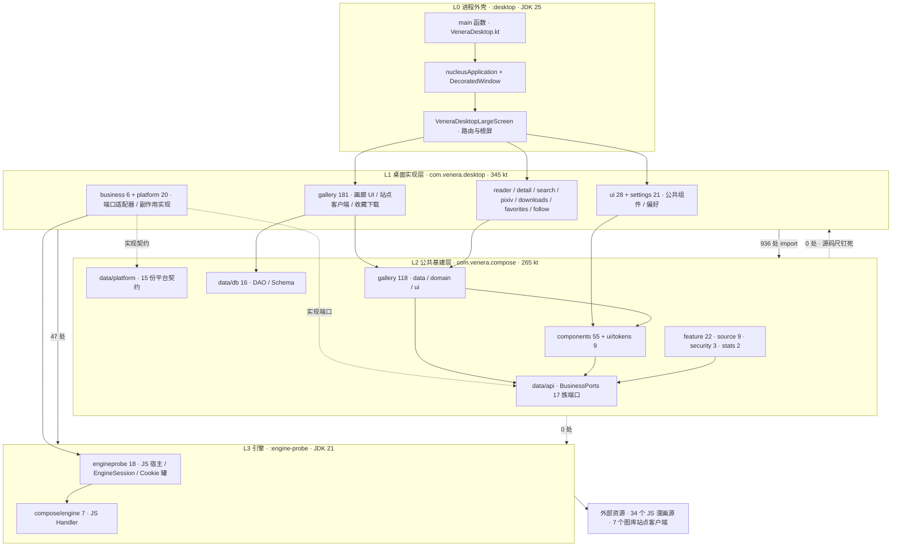

# 系统架构

本文描述 `:desktop` 的实际分层与隔离方式，内容以代码为准。仓库根为 `desktop/`。

## 1. 定位

单窗口 Compose Multiplatform 桌面应用，承担漫画阅读与图库浏览两条业务线。默认不联网启动，全部数据落在本机数据根。

| 项 | 值 |
|---|---|
| Gradle 模块 | 两个：`:desktop`、`:engine-probe` |
| UI 框架 | Compose Multiplatform 1.12.2（纯 JVM，非 KMP 多源集） |
| 语言 | Kotlin 2.4.10 |
| 构建 | Gradle 9.7.1 |
| 窗口宿主 | Nucleus（`nucleusApplication` + `DecoratedWindow`） |
| 生产源码规模 | 610 个 `.kt`，约 161,500 行 |
| 测试规模 | 264 个测试类，1690 条断言 |

## 2. 分层模型

四层，全部落在两个 Gradle 模块内。层级由包结构与测试守护，不由构建系统强制。

| 层 | Gradle 模块 | 包 | 文件数 | JDK | 职责 |
|---|---|---|---:|---|---|
| L0 进程外壳 | `:desktop` | `com.venera.desktop`（根） | 38 | 25 | `main`、窗口创建、路由根屏 |
| L1 桌面实现 | `:desktop` | `com.venera.desktop.*` | 319 | 25 | 桌面 UI、平台副作用实现、端口适配器 |
| L2 公共基建 | `:desktop` | `com.venera.compose.*` | 265 | 25 | 端口接口、平台契约、共享组件、共享画廊域 |
| L3 引擎 | `:engine-probe` | `com.venera.engineprobe`、`com.venera.compose.engine` | 25 | 21 | JS 宿主、`EngineSession`、Cookie 罐、JS handler |

关键事实：`com.venera.compose` **不是独立 Gradle 模块**，它是 `:desktop` 模块 `src/main/kotlin` 下的第二个一级包。修改共享层与修改桌面层属于同一个编译单元。

`:desktop` 另有一个 `src/probe/kotlin` 源集（`probe` compilation，`associateWith(main)`）：调试探针入口住在这里，不进安装包，也不参与 `compileKotlin`；测试源集同时关联 probe，以便直接验探针里的纯函数。兼作生产工具的窗口函数仍留在 `src/main`。

### L1 桌面实现层分布

| 包 | 文件数 | 职责 |
|---|---:|---|
| `desktop.gallery` | 181 | 画廊屏、卡片、详情面板、画师页；站点客户端；收藏、历史、下载管线 |
| `desktop.ui` | 28 | 命令栏、空态、快捷键、页模板、标题栏、公共组件 |
| `desktop.installer` | 8 | 安装向导独立窗口、四态场景、时间轴、外壳控件 |
| `desktop.settings` | 24 | 设置中枢与各类偏好单例 |
| `desktop.platform` | 20 | 路径、数据库端口、HTTP、文件选择、托盘、单实例、协议注册、更新检查 |
| `desktop.search` | 12 | 搜索屏、聚合搜索、来源筛选 |
| `desktop.reader` | 12 | 阅读器主屏、HUD、视口、图片滤镜 |
| `desktop.downloads` | 7 | 下载管线、本地漫画库、本地图片库 |
| `desktop.pixiv` | 6 | 账号、画师、登录、作品页 |
| `desktop.business` | 6 | `BusinessPorts` 的桌面适配器 |
| `desktop.sourcemanage` | 4 | 源管理、源登录 |
| `desktop.detail` | 4 | 详情屏、评论屏 |
| `desktop.favorites` | 3 | 收藏中枢与收藏屏 |
| `desktop.follow` | 7 | 追更：双因子判定、串行巡检器、详情追更端口、追更中心屏、网站收藏导入 |
| 其余 | 4 | 队列、历史、探索、缓存 |

### L2 公共基建层分布

| 包 | 文件数 | 职责 |
|---|---:|---|
| `compose.gallery` | 118 | 共享画廊层：data 40、domain 56、ui 22 |
| `compose.components` | 55 | 共享组件：卡片、侧栏、顶栏、玻璃、多选 |
| `compose.data` | 43 | api 8（端口）、db 16（DAO/Schema）、platform 15（契约）、update 4 |
| `compose.feature` | 22 | 共享功能内核与屏 |
| `compose.ui` | 9 | 颜色、间距、字体、动效令牌（`VeneraMotion` 是卡片入场与页面转场的唯一令牌源） |
| `compose.source` | 9 | 漫画源抽象、JS 载荷解析 |
| `compose.download` | 4 | 下载模型、章节选择、文件命名 |
| `compose.security` | 3 | 内容分级与屏蔽规则匹配 |
| `compose.stats` | 2 | 阅读统计模型与聚合 |

## 3. 依赖方向

方向是单向的，数字为 `import` 命中数。

| 方向 | 命中数 | 说明 |
|---|---:|---|
| `desktop` → `compose` | 936 | 允许 |
| `compose` → `desktop` | 0 | 禁止，由源码尺钉死 |
| `desktop` → `engineprobe` | 47 | 允许 |
| `compose` → `engineprobe` | 0 | 禁止 |
| `compose.gallery` → `compose.components` | 45 | 允许 |
| `compose.components` → `compose.gallery` | 0 | 禁止 |
| `compose.ui` → `compose.gallery` | 0 | 禁止 |

## 4. 隔离机制

### 4.1 单向包依赖

公共层不出现任何指向桌面实现的 `import`。这条由 `DesktopUiIsolationTest` 与 `DesktopNoAndroidImportTest` 守护。

### 4.2 依赖倒置

公共层只定义接口，不持有实现：

- 业务端口：`compose/data/api/BusinessPorts.kt`，17 个构造参数（`contentGuard`、`comics`、`sources`、`history`、`stats`、`favorites`、`downloads`、`localComics`、`network`、`updates` 等）。
- 平台契约：`compose/data/platform/`，15 份接口（`HttpEngine`、`KeyValueStore`、`SqlDatabase`、`PathProvider` 等）。

实现全部位于 `desktop/business`（端口适配器）与 `desktop/platform`（平台能力）。公共层因此没有可反向依赖的实现对象。

### 4.3 副作用单一出口

Toast、剪贴板、分享、显示模式读写、封面打码判据统一经 `LocalUxPlatformServices`，屏本体不出现平台 `import`。打码判据的分布由 `DesktopMaskJudgementSingleSourceTest` 固定。

### 4.4 编译面不含 Android 件

2026-11-17 起撤除了全部 `srcDir("../app/...")` 与 `exclude` 清单。Android 专有类型（`ViewModel`、`Activity`、`Intent`）在本仓不存在，引用会直接编译失败。

### 4.5 桌面侧禁用全局端口工厂

`BusinessPorts.of` 在桌面会抛异常。桌面一律直接构造 `DesktopBusinessPorts`。

### 4.6 追更数据流（core v4）

`comic_follow` 是追更的唯一事实源：详情页端口 `DesktopFollowDetailPort` 与巡检器 `DesktopFollowUpdateChecker` 都只经 `ComicFollowDao` 读写，不回写收藏表的 `has_update`。

- 判定：`FollowUpdateDiff` 纯函数，双因子（话数 / 末话 ID / 非空标题，无章节回退 `remoteUpdateTime`），首轮只建基线。
- 取数：`EngineFollowDetailSource` 按源 `forkEphemeral` 复用一个临时会话，一轮结束 `closeRound()` 释放，不抢窗口常驻会话的锁。
- 装配：巡检器在 `DesktopLargeScreenRouter`（唯一持 `engine` 的层）构造，经参数链下传 `DesktopTabHost`；TabHost 读账本流与进度，Hub 与追更屏只收成品。
- 导入：`DesktopNetworkFollowImporter` 分页取网站收藏 → 单事务整批写 `comic_follow` → 记 `comic_follow_sync_source`；单次上限 200 本、可随时取消。
- 备份：`.venera` 归档写入 `comic_follow.json` / `comic_follow_sync_source.json`，恢复走 `CoreTableBackup.importTable` 整表往返（列由 `PRAGMA table_info` 驱动）。

## 5. 架构图



## 6. 运行时链路

### 6.1 启动

`main` → 安装崩溃处理器 → 创建数据目录与运行日志 → 解析命令行取证参数 → `nucleusApplication` → `DecoratedWindow` → `VeneraDesktopLargeScreen`。

### 6.2 漫画源

随包 34 个 JS 脚本位于 `desktop/src/main/resources/sources/`。`EngineAssets.listSourceKeys` 枚举键名 → `DesktopSourceCatalogPort` 包装为 `DesktopEngineComicSource` → `EngineSession.load` 在 JS 侧注册 `ComicSource.sources[key]`。

默认启用 4 个：`baozi`、`copy_manga`、`jm`、`manga_dex`。

### 6.3 图库源

与漫画源是两套机制。图库侧以 `GallerySite` 枚举（7 个站点）加各站客户端实现，无注册表类。来源轴由 `GallerySearchSource` 组合多条腿。

## 7. 目录速查

```
desktop/
├── desktop/src/main/kotlin/com/venera/
│   ├── desktop/           L0 + L1
│   └── compose/           L2
├── desktop/src/test/kotlin/com/venera/desktop/   L0-L2 测试
├── engine-probe/src/main/kotlin/com/venera/      L3
├── docs/                                         本文档
└── gradle/libs.versions.toml                     版本目录
```

## 8. 已知不一致

`README.en.md` 尚未同步：仍描述「与 Android 共享同一份源码（经 `srcDir` 接进编译面）」，并引用不存在的 `docs/HANDOFF-2026-10-22.md`。该描述自 2026-11-17 起已失效，以本文为准。中文 `README.md` 已于 2026-11-21 修正。

`engine-probe` 命名易被理解为一次性探针，实际是生产依赖（`implementation(project(":engine-probe"))`）。

`DesktopSourceTree` 定义在 `src/test`，是测试用源码定位工具，生产代码引用为 0。
